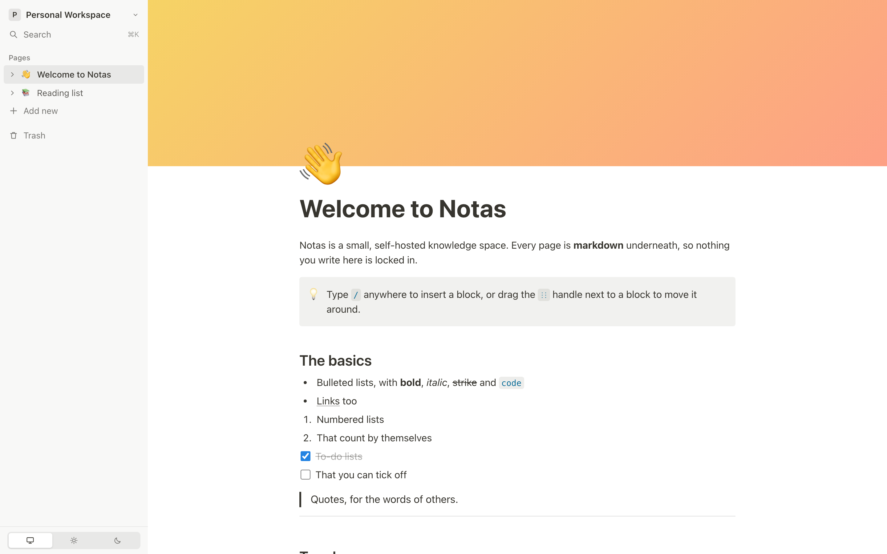

# Notas: Simple Knowledge Space for Self-Hosters



## Summary

Notas is a simple, self-hosted knowledge space.

It's a tree of pages with covers, emoji icons and a block editor, kept on your own server. Every page is stored as plain markdown in a SQLite database, so nothing you write is locked in.

Start the Notas container, and receive:

- a block editor with headings, lists, to-dos, tables, callouts, toggles, columns and more
- uploads and embeds for images, video, audio and files
- workspaces that can be shared with other users, to read or to edit
- search across every page
- ... and much more!

## Quickstart / Demo

```sh
docker run --rm -p 3000:3000 -e INTERACTIVE_DEMO=true butterhosting/notas
```

## Documentation

Please visit [www.butterhost.ing/notas](https://www.butterhost.ing/notas) for the full documentation, covering deployment, users and workspaces, backups, tips, tricks and more.
